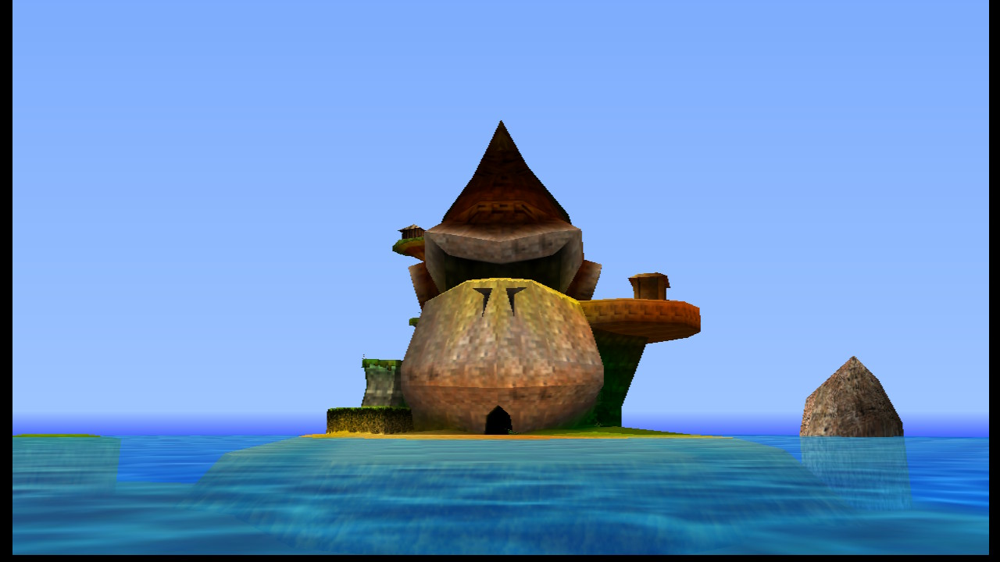
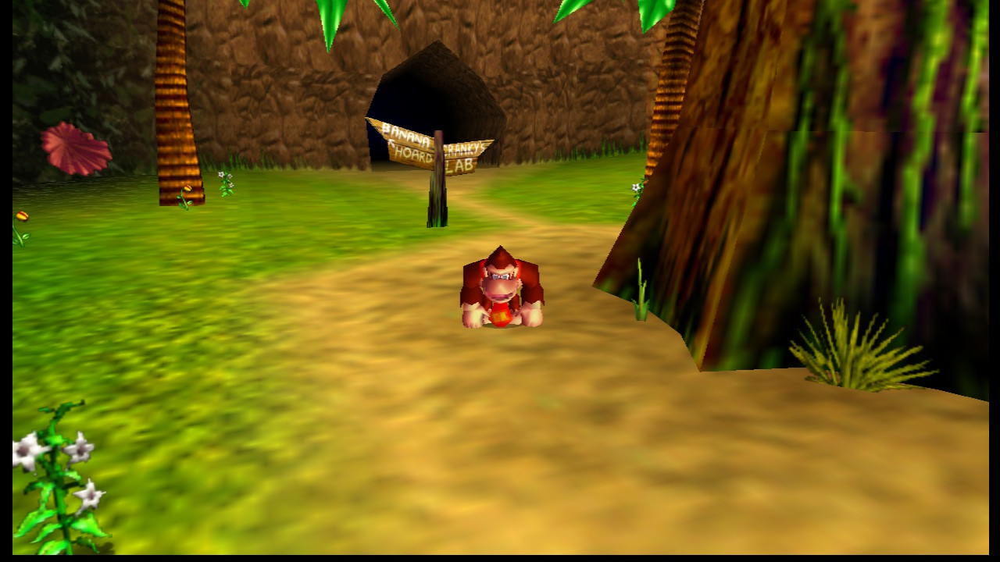
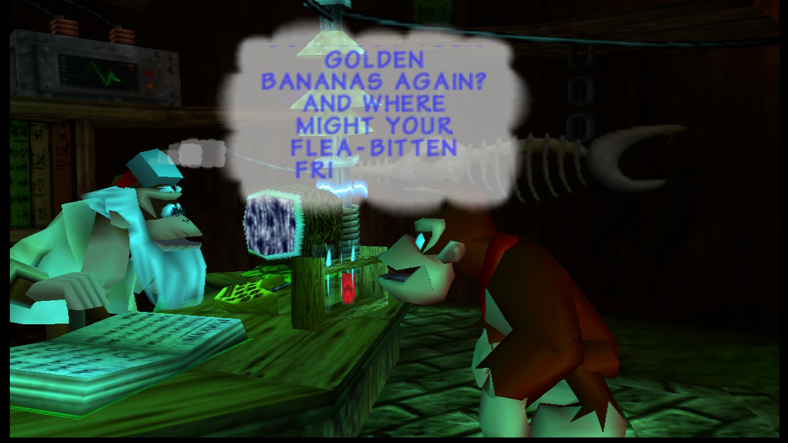
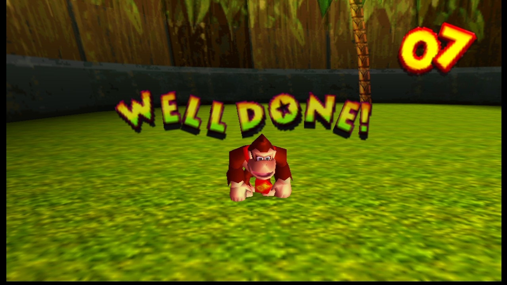

# DK64: Recompiled for Nintendo Switch
*Homebrew port of [Donkey Kong 64: Recompiled](https://github.com/Rainchus/Donkey-Kong-64-Recompiled) 1.0.3. For the PC version, see the upstream repository.*

The game code is the same static recompilation as the PC release. What changes is everything
around it: the renderer (GLideN64 instead of RT64), the OS layer and the threading model.

| Measured on hardware | |
|---|---|
| Frame rate | 30 fps, the game's original rate |
| Resolution | 960×720 (3× native), 16:9 widescreen with the HUD at the screen edges |
| Audio | 48 kHz, in real time, no dropouts |
| Saves | Yes |

<p align="center">
  
  
  
  
</p>
<p align="center"><sub>Captured on a Nintendo Switch with the console's Capture button.</sub></p>

# Quick Start

DK64Recomp-NX does not include any copyrighted assets. You are required to provide a supported
copy of the game.

### 1. Verify your ROM dump

Only **Donkey Kong 64 (USA)** is supported.

US SHA-1 (`.z64`): `cf806ff2603640a748fca5026ded28802f1f4a50`

`.n64` and `.v64` dumps also work (they are converted on first launch), but their hash differs from
the one above. To check a `.z64` dump:
* Windows: `certutil -hashfile "Donkey Kong 64 (USA).z64" SHA1`
* macOS: `shasum "Donkey Kong 64 (USA).z64"`
* Linux: `sha1sum "Donkey Kong 64 (USA).z64"`

### 2. Download DK64Recomp-NX from [Releases](https://github.com/Trinalord777/DK64Recomp-NX/releases)

### 3. Copy the files to your SD card

Put the `.nro` and your ROM in the same folder (the ROM file name does not matter):

```
sdcard
└── switch
    └── dk64recomp
        ├── dk64recomp.nro
        └── Donkey Kong 64 (USA).z64
```

### 4. Launch the game

Launch via Atmosphère's **Game+R** method: hold **R** while starting any game, then pick
*DK64: Recompiled* in the Homebrew Menu. The game needs full RAM access; launched from the Album
(applet mode), it does not have enough memory.

On first launch the ROM is checked and a copy is stored as `DK64.z64` in the same folder.

### 5. Play!

Congratulations, you are now back on DK Isles! Have fun!

Your saves are in `sdmc:/switch/dk64recomp/saves/`.

# Controls

| N64 | Nintendo Switch |
| - | - |
| **A** | **A** |
| **B** | **B** |
| **Z** | **ZL** |
| **L** | **L** |
| **R** | **R** / **ZR** |
| **Start** | **+ (Plus)** |
| **Control Stick** | **Left Stick** |
| **C Buttons** | **Right Stick** (camera) |
| **D-Pad** | **D-Pad** |

Press **− and +** together during the game to open **NX Options**.

# Settings

**NX Options** (− and + together) holds the PC version's options. Move with the D-Pad or the left stick, change a
value with Left/Right or **A**, close with **B** or − and + again. The game does not react to the pad while the menu
is open.

| Section | Options |
|---|---|
| Camera | Camera type, analog camera sensitivity, invert camera, first person and swimming |
| Game | Story skip, lightning flashes, cutscene borders, draw distance |
| Audio | Music and sound effects volume |
| Display | Show FPS, aspect ratio (16:9 or 4:3), resolution (2x or 3x) |
| Performance | Frame rate (30 fps, or 60 fps interpolated, experimental), clock profile |
| Controls | Face buttons (swap A and B in the game) |
| Cheats | The GameShark codes of `cheats.cht`, on or off |
| System | Quit Game, back to the homebrew menu |

**60 fps (interpolated)** is experimental: the game still runs at its original 30 fps, and an in-between image,
with every object halfway between two of its frames, is drawn and shown between them, as the PC version does with
RT64. It adds one frame of latency. Camera cuts are not interpolated.

**Cheats** come from `sdmc:/switch/dk64recomp/cheats.cht`, in libretro's format: copy
[Donkey Kong 64 (U).cht](https://github.com/libretro/libretro-database/blob/master/cht/Nintendo%20-%20Nintendo%2064/Donkey%20Kong%2064%20(U).cht)
from libretro-database there and rename it. Codes that change the game's data (ammo, health, bananas, coins)
work; codes that patch the game's instructions do not, since the game runs as recompiled code, and the menu marks
them Unsupported. The cheats left on are remembered in `cheats_enabled.txt`.

**Clock profile** raises the clocks in handheld mode only, while the game is in the foreground:
*Docked GPU in Handheld* is the console's official docked GPU profile (768 MHz); *Horizon OC Docked Clocks*
applies the docked CPU, GPU and RAM clocks set in [Horizon OC](https://github.com/Horizon-OC/Horizon-OC), if it
is installed. Both are released when you leave the game.

Changes apply immediately, except the aspect ratio and the resolution, which apply the next time the game
starts. They are saved to `sdmc:/switch/dk64recomp/nx_options.txt` when the menu closes. By default the game
runs at its original 30 fps, in 16:9 with the HUD at the screen edges, at 960x720 (3x native), without cutscene
borders.

# Troubleshooting

* **"No valid Donkey Kong 64 ROM found"**: the ROM must be in `sdmc:/switch/dk64recomp/` and be the USA version (hash above).
* **Crash or black screen on launch**: make sure you used Game+R, not the Album.
* Each run writes `sdmc:/switch/dk64recomp/dk64recomp.log`. Attach it when you open an
  [issue](https://github.com/Trinalord777/DK64Recomp-NX/issues); after a crash it contains the
  faulting address.

# Development

### Building

Requirements: git, Docker and python3. The scripts run in the `ubuntu:24.04` and
`devkitpro/devkita64` images, so nothing else is installed on your machine.

```bash
git clone https://github.com/Trinalord777/DK64Recomp-NX
cd DK64Recomp-NX
git submodule update --init --recursive lib/N64ModernRuntime lib/GLideN64 lib/dk64_decomp
git submodule update --init lib/rt64
git -C lib/rt64 submodule update --init src/contrib/imgui
# 1. Recompile the game from your ROM (once per ROM, ~5 min)
docker run --rm -v "$PWD:/work" -v "/path/to/rom/folder:/rom:ro" ubuntu:24.04 bash /work/switch/codegen.sh "/rom/Donkey Kong 64 (USA).z64"
# 2. Build the .nro (~10 min the first time)
switch/build.sh
```

The result is `switch/build/dk64recomp.nro`. Nothing derived from the ROM is tracked in git.

### Testing without copying files

Start the Homebrew Menu, press **Y**, then run `nxlink -s switch/build/dk64recomp.nro` from
devkitPro's `switch-tools`. The game's log streams to your terminal.

### Remote test build

`DK64NX_DEV=1 switch/build.sh` builds `switch/build-dev/dk64recomp.nro` with a test server on TCP port 28280
that injects pad input, captures the screen and reads the game's memory, driven from your computer with
`switch/dk64nx_remote.py`. It has no authentication: use it on your own network only. Release builds never
include it.

### How it works

The PC port draws with [RT64](https://github.com/rt64/rt64), which needs Vulkan, D3D12 or Metal.
Horizon homebrew has none of them, so the renderer is replaced by
[GLideN64](https://github.com/gonetz/GLideN64) on OpenGL (mesa nouveau). Both read the same
mupen64plus `GFX_INFO` view of the recompiled RDRAM, so GLideN64 plugs into the runtime's
`RendererContext` without converting anything.

| Piece | What it does |
|---|---|
| `switch/gliden64_rt64ex.cpp` | Decodes the RT64 extended GBI (opcode `0x64`) that DK64R's patches emit: rectangles, scissors, viewports, extended RDRAM addresses, and the alignment hints used for widescreen |
| `switch/render_gliden64.cpp` | `RendererContext` over GLideN64, plus the present hold described below |
| `switch/core_switch.cpp` | Minimal mupen64plus core: in-memory config and video extension over SDL2 |
| `switch/main_switch.cpp`, `input_switch.cpp`, `frontend_switch.cpp` | Entry point, audio, controllers, and the settings the PC menus would set |
| `switch/threads_switch.c`, `mman_switch.c`, `crash_switch.c`, `shim/` | libnx gaps: thread stacks and cores, `mmap`, a crash handler that prints module offsets |
| `switch/patches/` | Changes to the pinned N64ModernRuntime, N64Recomp and GLideN64 commits, applied by `build.sh` |

### Problems found on hardware

| Symptom | Cause | Fix |
|---|---|---|
| Abort at startup | libnx has no `pthread_detach` | `--wrap=pthread_detach` no-op |
| "Failed to write to the save file" | libstdc++'s `copy_file` ends with `fchmod`, which the SD driver rejects | Save rotation with renames (`files.cpp`) |
| Freeze on the Nintendo logo | GLideN64 presents on the graphics thread and blocks on vsync; the action queue never drained and the VI producer starved display lists | Skip a screen update when a newer one is already queued (`events.cpp`) |
| High-pitched, distorted music | Upstream's latency guard divides by the game's rate (22 050 Hz) instead of the output rate (48 000 Hz) | Latency measured at the output rate; drop whole chunks past 250 ms |
| Music cutting out | 256-frame SDL buffers; the Switch backend releases one per ~10 ms | 1024-frame buffers |
| Image jitter in motion only | DK64 starts frame N+2 in the buffer still on screen and relies on the RDP freeze to hold it back; the runtime does not freeze, so frames showed as N, N+2, N+1… | Do not re-present a front buffer that was redrawn (one held present per frame, 60 per 2 s, confirmed on hardware) |
| Widescreen | RT64's *Expand* has no GLideN64 equivalent | GLideN64's 16:9 adjust mode, steered by DK64R's RT64 alignment commands: HUD anchored left/right, sky and backgrounds stretched, screen transitions anchored as on PC |

# Licensing

This fork is GPL-3.0, like upstream. GLideN64 is licensed under GPL version 2 without the
"or later" clause, which is not compatible with GPL-3.0 inside one binary. Building from source
for your own use is unaffected.

# Special Thanks

* Rainchus and the [DK64: Recompiled](https://github.com/Rainchus/Donkey-Kong-64-Recompiled) team
* The [dk64 decompilation](https://gitlab.com/dk64_decomp/dk64) team
* Wiseguy for [N64Recomp](https://github.com/N64Recomp/N64Recomp) and N64ModernRuntime
* gonetz and the [GLideN64](https://github.com/gonetz/GLideN64) contributors
* The HarbourMasters Switch ports ([PaperBoat-NX-Modern](https://github.com/Thorhax/PaperBoat-NX-Modern),
  [Docklight](https://github.com/PalindromicBreadLoaf/Docklight),
  [2ship2harkinian-Switch](https://github.com/YoshiCrystal9/2ship2harkinian-Switch)) for the libnx/mesa platform recipe
* devkitPro for devkitA64 and libnx

<sub>Ported with the help of Claude (Anthropic), tested on real hardware.</sub>
